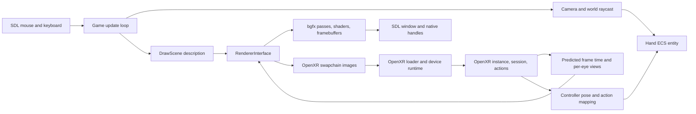

# OpenBlack Native Steam Frame VR Roadmap

This guide describes the current OpenBlack code and SteamOS headset environment, the components needed for native VR, and a staged implementation path. The target is this machine: it reports `aarch64`, runs SteamOS `VARIANT_ID=vr`, and has SteamVR running. SteamVR supplies an ARM64 OpenXR runtime, so the planned app interface is OpenXR through the runtime already installed on the device. The first engineering risk to resolve is sharing graphics resources between OpenXR and OpenBlack's bgfx Vulkan renderer.

For the block-by-block learning path, code explanations, and API references, follow the [OpenXR tutorial](OPENXR_TUTORIAL.md). This roadmap tracks platform findings and engine integration; the tutorial tracks the standalone probe exercises.

The [exercise-driven course outline and lifecycle pilot](OPENXR_COURSE_PILOT.md)
are available for format review, with a [separate solution](OPENXR_PILOT_SOLUTION.md).
This proposal does not change the working probe or establish new on-device results.

## Goal and Current Status

The goal is to build OpenBlack natively on the headset, launch it through the supported SteamVR app path, render the game in both headset eyes, and use tracked controllers to interact with the island while preserving desktop input and rendering.

The starting points are:

- The machine already has an ARM64 compiler/build environment, Vulkan support, the OpenXR loader development files, and SteamVR's ARM64 OpenXR runtime.
- Desktop Vulkan rendering and camera/input are confirmed through the RDP X11 session (`DISPLAY=:10.0`); the SSH shell still fails on unsupported KMSDRM. Closing the desktop window caused a segmentation fault, recorded as a separate baseline cleanup defect.
- The standalone probe has created an OpenXR instance, reported `SteamVR/OpenXR` version `2.17.10`, discovered an HMD system, enabled `XR_KHR_vulkan_enable2`, and queried a Vulkan API range of `1.0.0` through `1.2.0`. On 2026-10-15, Vulkan instance creation, runtime-selected GPU `Turnip Adreno (TM) 750` (Vulkan `1.4.359`), graphics queue family 0, logical-device creation, and Vulkan-backed OpenXR session creation/cleanup were confirmed. Session-event observation is the current exercise; session beginning and headset frame submission are not yet verified.
- OpenBlack currently builds as an SDL2 desktop application and renders through bgfx. It has no OpenXR dependency, session lifecycle, stereo view family, or tracked-controller input path.
- The game loop and current mouse-driven Hand interaction live in `src/Game.cpp`. Renderer ownership is centered in `src/Graphics/Renderer.cpp` and the `RendererInterface` contract.
- The base game requires legally obtained original Black & White data. Keep those files outside the repository and pass their directory using `-g`.

The implementation should keep non-VR behavior intact, verify each platform boundary on-device, and only add engine integration after a small OpenXR application can enter the headset and graphics interop is understood.

## What Exists in This Checkout

| Component | Current responsibility | Design implication |
| --- | --- | --- |
| [`src/main.cpp`](src/main.cpp) | Parses command-line options, creates `Game`, and starts it. `-g`/`--game-path` points to the original game data. | Keep headset lifecycle in an engine service; add only mode/configuration options here if needed. |
| [`src/Game.cpp`](src/Game.cpp) and [`src/Game.h`](src/Game.h) | Initializes services and game data, pumps SDL events, updates game systems, prepares one scene draw, draws the GUI, and advances the renderer frame. | This is the frame-loop integration point, but it currently has no OpenXR frame lifecycle. |
| [`src/Windowing/`](src/Windowing/) | SDL2 creates the app window and exposes native window/display handles to bgfx. | Must be checked against the device's VR app/window model. A headset runtime may require more than a normal desktop SDL window. |
| [`src/Graphics/RendererInterface.h`](src/Graphics/RendererInterface.h) and [`src/Graphics/Renderer.cpp`](src/Graphics/Renderer.cpp) | Renderer abstraction and its bgfx implementation; selects a bgfx backend and owns bgfx initialization, render passes, framebuffers, and frame submission. | The renderer owns critical graphics state. OpenXR must share or receive compatible graphics resources; a parallel, unrelated Vulkan device will not make its swapchain images renderable by bgfx. |
| [`src/Graphics/RenderPass.h`](src/Graphics/RenderPass.h) | Assigns bgfx view IDs for footprint, reflection, main scene, ImGui, and mesh viewer passes. | Reserve new IDs centrally; existing IDs 0 and 1 are already used. |
| [`src/Graphics/ShaderManager.cpp`](src/Graphics/ShaderManager.cpp) and [`src/Camera/Camera.h`](src/Camera/Camera.h) | Supplies the current camera's view/projection matrices to a bgfx view; the camera also provides screen/world projection and raycast helpers. | Per-eye poses and asymmetric OpenXR projections need to reach the renderer without corrupting the existing desktop camera path. |
| [`src/Game.cpp`](src/Game.cpp) and [`src/ECS/Systems/Implementations/HandSystem.cpp`](src/ECS/Systems/Implementations/HandSystem.cpp) | Game input uses SDL mouse state, deprojects the mouse through the camera, raycasts into the world, and moves the left-hand entity to the intersection. The hand ECS system updates hand-related world effects. | Reuse the world raycast and hand entity concepts, but introduce a tracked-controller input source and an explicit tracking-to-game-world mapping. |
| [`components/`](components/) and [`src/`](src/) | `components/` contains format/library targets; `src/` contains the game executable/library and runtime systems. | Put VR integration in a small runtime subsystem and renderer adapter, rather than mixing OpenXR calls into asset-format libraries. |
| [`CMakeLists.txt`](CMakeLists.txt), [`CMakePresets.json`](CMakePresets.json), and [`vcpkg.json`](vcpkg.json) | Configure required libraries, platform presets, and vcpkg dependencies. | Add OpenXR as an optional native Linux dependency; use the Linux preset, not the Android ARM64 preset. |
| [`readme.md`](readme.md) | Build instructions and lawful extraction guidance for original game assets. | The game assets remain a separate prerequisite; do not bundle copyrighted files with builds. The `-g` path must resolve the expected game directories. |

The project currently selects Vulkan by default on non-Apple systems, but that only selects the bgfx renderer. It does not initialize OpenXR or imply compatibility with a headset runtime.

## Tools Present on This Machine

The following were observed on the SteamOS target on 2026-10-12, with build and probe findings updated through 2026-10-14:

| Tool or capability | Observed result | How it is used here |
| --- | --- | --- |
| Architecture and OS | `aarch64`; SteamOS, `VARIANT_ID=vr` | Native configure/build is appropriate; do not select the Android ARM64 preset. |
| CMake | 3.29.2 | Reads this repository's configure/build presets and drives configure/build. |
| Ninja | Installed | Used by the vcpkg Ninja preset; the system-deps preset uses Unix Makefiles. |
| GCC/G++ and Clang/Clang++ | Installed | Native C++ compilers. CMake selects its compiler at first configure; set `CC`/`CXX` before configuring only if intentionally choosing another one. |
| pkg-config | Installed | Queries installed system library metadata and emits include/link flags for small probes. |
| SDL2 development metadata | 2.30.2; the built executable reports compiled/linked SDL 2.32.10 | OpenBlack's window, event, and desktop input dependency. System pkg-config metadata and the vcpkg-linked build need not identify the same installation. |
| OpenXR development metadata | 1.1; pkg-config emits `-lopenxr_loader` | Headers are usable, but the default system library failed to link the probe. Use the diagnostic loader command below; metadata alone does not verify a usable library. |
| Vulkan development metadata | 1.4.309; pkg-config emits `-lvulkan` | Separate from the runtime's queried OpenXR graphics API range of Vulkan 1.0.0 through 1.2.0. |
| Vulkan tools/driver | `vulkaninfo` reports Vulkan 1.4 and Turnip/Mesa on Qualcomm Adreno 750 | Confirms a Vulkan device/driver is visible. The SSH/no-display invocation skips display-surface information. |
| SteamVR/OpenXR runtime | The probe reports `SteamVR/OpenXR` version `2.17.10` and discovers an HMD. `/opt/steamvr/steamxr_linuxarm64.json` names SteamVR; its relative `bin/linuxarm64/vrclient.so` exists. | Discovery is verified in the tested terminal environment, not yet through the final headset app launch route. Do not hard-code a runtime manifest. |
| `openxrinfo` utility | Not found on PATH | Do not use instructions that assume this diagnostic program is installed; the Stage 1 probe is still needed. |

Reference the installed tools from the repository root with:

```sh
cd /home/steamos/david/openblack
uname -m
cmake --version
ninja --version
g++ --version
pkg-config --modversion sdl2
pkg-config --modversion openxr
pkg-config --cflags --libs openxr
vulkaninfo --summary
cmake --list-presets
```

`pkg-config --cflags --libs openxr` shows the advertised compiler and linker flags, but the default system loader failed the actual probe link; see the diagnostic workaround below. The project itself uses CMake `find_package` for its dependencies, so a pkg-config result is a diagnostic and not a replacement for a successful project configure. In particular, bgfx does not provide pkg-config metadata in this environment; CMake must still find the bgfx package expected by this checkout.

The conventional `/usr/share/openxr/1` directory contains API-layer data but no active-runtime manifest, `/etc/openxr/1` is absent, and `XR_RUNTIME_JSON` is unset in this shell. Separately, `/opt/steamvr/steamxr_linuxarm64.json` registers SteamVR's native ARM64 OpenXR runtime, and SteamVR is currently running. Steam's Lepton container overlay also has an `active_runtime.json` for SteamVR, so runtime selection may be supplied through its managed app environment. Verify which runtime manifest a native OpenBlack process sees when launched through the supported headset path; do not hard-code the container path. `vulkaninfo --summary` was run without `DISPLAY`, so run surface diagnostics from the supported graphical/headset session when needed.

## System and Frame Flow



The diagram shows the desired connections, not functionality already present. In the current code, SDL and bgfx drive one desktop window, `Game` draws one main scene camera, and OpenXR has no role.

## Build OpenBlack on the Headset

Build directly on this Steam Frame environment. It is already the native ARM64 target, so no cross toolchain, sysroot, or Android preset is needed. The repository has no generic Linux ARM64 cross preset; the Android ARM64 preset is not a substitute.

### Confirmed Build Route

The `linux-system-deps` preset currently fails on this machine because the system STB headers are not installed (`Stb_INCLUDE_DIR-NOTFOUND`). Do not retry that preset to get past this error. Use the repository's vcpkg preset instead: it selected the native `arm64-linux` triplet, installed the declared dependencies including STB, and configured successfully. The native Release build completed, the executable's `--help` output works, and all seven Release tests pass.

1. Confirm the checkout and available presets:

   ```sh
   git submodule update --init --recursive
   cmake --list-presets
   ```

   The checked-in submodule is vcpkg. bgfx is obtained through the dependency setup, not as a declared git submodule.

2. Configure with vcpkg and build the native Release target:

   ```sh
   cmake --preset ninja-multi-vcpkg
   cmake --build --preset ninja-multi-vcpkg-release --parallel 4
   ```

   The first configure downloads/builds the dependency set and can take several minutes. On this machine vcpkg detected `/usr/bin/c++` and selected `arm64-linux`; subsequent configures reuse the installed packages. `linux-system-deps` remains an option only after its missing system dependencies, including STB, are provided through a SteamOS-supported package/development environment.

3. Check the executable and run the tests:

   ```sh
   ./cmake-build-presets/ninja-multi-vcpkg/bin/Release/openblack --help
   ctest --preset ninja-multi-vcpkg-release
   ```

   These checks were run successfully on this machine: all seven tests passed. `--help` confirms the executable starts but does not initialize graphics or prove headset support.

4. Keep the original game data outside the source tree. The directory containing `Data` and `Scripts` is accepted by the `-g` option; audio data is also used. This command rendered the island and allowed camera movement/interaction when run from the RDP X11 terminal:

   ```sh
   ./cmake-build-presets/ninja-multi-vcpkg/bin/Release/openblack \
     -g "/home/steamos/david/games/Black & White/" -b Vulkan -l stdout
   ```

### Current On-Device Launch Finding

On 2026-10-13, an SSH-shell Vulkan launch aborted with `Unsupported platform or window manager: 13`. In SDL 2.32.10, subsystem value 13 is `SDL_SYSWM_KMSDRM`. That shell had no `DISPLAY` or `WAYLAND_DISPLAY`, so SDL created a direct KMSDRM window. [`src/Windowing/Sdl2WindowingSystem.cpp`](src/Windowing/Sdl2WindowingSystem.cpp) currently extracts native handles for Wayland, X11, Windows, macOS, Vivante, and Android, but not KMSDRM. The bundled bgfx Vulkan backend supports Wayland and Xlib/XCB surfaces; it has no KMSDRM surface path. This is a window/backend compatibility gap, not an asset-path or Vulkan-driver error.

Do not work around this by treating SDL's KMSDRM file descriptor or GBM device as an X11/Wayland window. SDL marks those KMSDRM handles unavailable for Vulkan windows, and bgfx has no matching KMSDRM native-handle type.

The same asset path was tested with `-b Noop -l stdout -n 1`: OpenBlack initialized, progressed through game-data/level loading, and shut down without the KMSDRM exception. It logged several currently unimplemented game-script functions and asset warnings, so this confirms the directory is readable, not that the game is fully playable.

The RDP terminal provided `DISPLAY=:10.0`, with `WAYLAND_DISPLAY` and `SDL_VIDEODRIVER` empty. In that X11 session, the island rendered and camera movement/interaction worked. Wayland is therefore not a prerequisite for continuing. This does not establish desktop rendering from SSH or the final SteamVR app launch route.

Closing the RDP game window produced `Segmentation fault (core dumped)` after audio cleanup messages. Record this as a window-close/cleanup defect, not a failure to render. The preceding audio messages do not identify the cause; obtain a backtrace before assigning it to a subsystem. Resolve or characterize it before engine lifecycle integration. Asset warnings and unimplemented script messages also remain; the successful desktop test does not imply full game compatibility.

**Next step:** continue the independent OpenXR probe below. Do not force a Wayland driver in the SSH shell or add KMSDRM handle workarounds. VR rendering must target OpenXR swapchains rather than depend on an unsupported KMSDRM desktop-present surface.

### Standalone OpenXR Probe Findings (2026-10-14)

The probe is a separate learning executable, not OpenXR engine integration. Its verified output includes:

```text
XR_KHR_vulkan_enable2 advertised: yes
fdm_injection: XR layer loaded
Runtime: SteamVR/OpenXR
Version: 2.17.10
HMD system discovered.
Minimum Vulkan API: 1.0.0
Maximum Vulkan API: 1.2.0
```

This verifies instance creation, runtime identity, HMD system discovery, extension enumeration, enabling `XR_KHR_vulkan_enable2`, and calling `xrGetVulkanGraphicsRequirements2KHR`. The layer message is diagnostic output, not a reported failure; its purpose has not been investigated. Advertised extensions are not automatically enabled and do not establish support for every feature on the connected hardware.

The returned Vulkan range describes OpenXR graphics integration requirements, not the GPU driver's maximum Vulkan capability. For the next exercise, explicitly request Vulkan 1.2 after checking it falls in that range. OpenXR's `XrVersion` encoding (`XR_MAKE_VERSION`) differs from Vulkan's API-version encoding (`VK_API_VERSION_1_2`); do not assign one directly to the other.

#### Loader link failure and working diagnostic command

Linking with `$(pkg-config --cflags --libs openxr)` or explicit `-lopenxr_loader` produced undefined references to core functions such as `xrCreateInstance`. Header compilation succeeded; this was a link-stage failure.

Inspection found only `/usr/lib/libopenxr_loader.a` in the default library directory, owned by `gfxreconstruct`. Its members contain LTO data, and the symbol tools reported that a plugin was needed to read them. The exact archive/toolchain failure has not been fully diagnosed. SteamVR's `/opt/steamvr/bin/linuxarm64/libopenxr_loader.so` is an ARM64 shared loader with the required exported functions; linking it directly allowed the probe to run.

From the directory containing the probe, the working command is:

```sh
g++ -std=c++17 -Wall -Wextra -Wpedantic \
  xr_probe.cpp -o xr_probe \
  /opt/steamvr/bin/linuxarm64/libopenxr_loader.so \
  -Xlinker -rpath -Xlinker /opt/steamvr/bin/linuxarm64

./xr_probe
```

Add `-lvulkan` when the probe starts calling Vulkan functions directly. The rpath is a shared-library search path; it does not select an OpenXR runtime manifest. No explicit runtime override was needed for the successful reported run. This is a device-specific diagnostic command, not the permanent OpenBlack dependency configuration. Do not replace system libraries or hard-code this path into engine source.

#### Probe structure and next exercises

The standalone [probe](src/VR/xr_probe.cpp) shares error handling through `CheckXr(instance, result, operation)` and extension lookup through `LoadXrFunction<PFN_...>(instance, name)`. The typed loader checks the lookup result, reports null pointers, and returns the requested function-pointer type. Callers gate dependent operations on a non-null result. Keep resource creation, API-specific output checks, and cleanup explicit; loading an entry point does not call it or create a graphics resource.

`CheckXr` also handles pre-instance and post-destruction errors numerically when passed `XR_NULL_HANDLE`. `CheckRequiredExtension` owns enumeration and retries if the list grows between count and fill calls. `PrintXrVersion` shares OpenXR version formatting. `ProbeGraphics` follows the runtime/system/requirements/Vulkan/GPU stages with early returns instead of nested success blocks; `main` retains ownership and always cleans up created instances after the probe returns. Block comments explain version encodings, prerequisites, result channels, and borrowed versus owned handles.

The refactored probe compiled with `-Wall -Wextra -Wpedantic -Werror` and completed a device smoke test on 2026-10-15. `xrGetVulkanGraphicsDevice2KHR` selected `Turnip Adreno (TM) 750`; its reported Vulkan API was `1.4.359`. This does not change the OpenXR graphics requirements range of 1.0 through 1.2.

1. Obtain `xrCreateVulkanInstanceKHR` using `xrGetInstanceProcAddr`.
2. Create a Vulkan 1.2 instance through that function, passing `vkGetInstanceProcAddr` and the discovered HMD system ID. Check both the returned `XrResult` and output `VkResult`.
3. Destroy the application-owned Vulkan instance with `vkDestroyInstance`, then destroy the OpenXR instance. This creation/cleanup exercise was confirmed by the user's successful run on 2026-10-15.
4. Runtime-required physical GPU selection, graphics queue family 0 (one graphics queue), logical-device creation through `xrCreateVulkanDeviceKHR`, queue retrieval, and graphics-bound OpenXR session creation/cleanup were confirmed by subsequent user runs on 2026-10-15.
5. Confirmed on 2026-10-15: `PRIMARY_STEREO` support; both views recommend 1728x1728 images, maximum 8192x8192, with recommended/maximum swapchain sample count 1. Event observation reported `IDLE` (1), then `READY` (2), without beginning the session, followed by expected teardown messages. Next: enumerate environment blend modes before implementing a running-session frame loop. See the [tutorial](OPENXR_TUTORIAL.md#102c-query-environment-blend-modes).
6. Then handle session begin/end, reference spaces, stereo views, swapchains, frame submission, and controller actions. No headset image or tracking/input test is verified yet.

These probe resources must not become an unrelated second graphics device attached to OpenBlack. Prove compatible ownership and synchronization with bgfx before engine integration.

## Recommended VR Design

Keep the current desktop route working. Add an optional OpenXR path behind a CMake option, but only after the runtime and graphics interop have been demonstrated. Prefer normal CMake conditionals and a runtime mode/configuration over scattering `#ifdef` blocks across game and renderer code.

### Runtime and graphics ownership

OpenXR has distinct loader and runtime roles. The loader dispatches calls; SteamVR supplies the headset, tracking, and compositor through the native ARM64 OpenXR runtime installed at `/opt/steamvr`. Installing headers or linking the loader does not prove the native OpenBlack process is launched with that runtime selected or that the runtime supports the graphics API path the application uses. Do not hard-code a runtime manifest path or the Lepton container overlay path. Verify runtime discovery using the same Steam/SteamVR launch route intended for OpenBlack and a small OpenXR test program.

Before project integration, make a small native ARM64 OpenXR probe that:

- Runs from the device's supported SteamVR/VR application context, creates an instance and HMD system, enumerates supported view configurations and graphics requirements, and prints the runtime/version and extensions. Confirm it reports the SteamVR runtime named in `/opt/steamvr/steamxr_linuxarm64.json`.
- Creates and runs a session using the graphics API the device runtime actually supports; handles session-state events rather than assuming it is immediately running.
- Calls the frame lifecycle in the required order (`xrWaitFrame`, `xrBeginFrame`, view location, swapchain image acquire/wait/release, and `xrEndFrame`).
- Renders a simple test scene to the runtime's swapchain and verifies both eye images and head tracking in the headset.

Then prove that bgfx can render into those swapchain images on that target. OpenXR Vulkan session creation must use a Vulkan device compatible with the runtime's requirements. The current bgfx factory initializes bgfx itself from SDL native window handles; it does not expose an OpenXR-owned Vulkan device or a swapchain-image import abstraction. If safe, supported interop cannot be demonstrated, choose deliberately between extending the bgfx backend integration and using a dedicated VR-capable rendering backend. Avoid maintaining two competing graphics devices or copying full-resolution eye images every frame as a first design.

### Suggested module boundaries

The eventual implementation can live in a new `src/VR/` (or `src/XR/`) subsystem with these responsibilities. These are design roles, not existing classes:

- **Session/runtime service:** OpenXR instance/system/session creation, extension selection, event polling, session state, reference spaces, and orderly shutdown.
- **Frame/view provider:** predicted display time, located views, per-eye FOV/projection, and a frame-scoped description passed to rendering. Keep OpenXR timing and frame begin/end calls in one owner.
- **Swapchain/graphics bridge:** swapchain formats, image acquisition and release, and the chosen Vulkan/bgfx interop. Runtime images are borrowed resources with lifecycle constraints; do not treat them as ordinary `FrameBuffer` objects without validating ownership and synchronization.
- **Input adapter:** OpenXR action sets, interaction profiles, controller action/pose spaces, and conversion into game actions. Keep physical device bindings out of core gameplay logic.
- **Tracking-to-world mapper:** configurable origin, scale, orientation, and play-space policy. Convert meters in the OpenXR reference space into the game's world units and keep camera movement comfortable.

Let `Game` coordinate these interfaces. Keep the existing non-VR `RendererInterface` path and add a renderer-facing view family or equivalent input describing one or more camera views and their render targets. `Renderer::DrawPass` and `ShaderManager::SetCamera` are closer to the point that must consume per-eye matrices than `main.cpp` or a hypothetical `Camera.cpp` at `src/camera/`.

### Stereo and the existing render graph

OpenXR supplies each view's pose and FOV; derive the eye view/projection matrices from that data. Do not use a symmetric desktop projection or simply offset the existing camera. OpenBlack's GLM configuration is left-handed and its camera supports reversed-Z, so projection conversion and depth conventions need deliberate validation against the runtime.

Allocate distinct bgfx view IDs for every pass that must be rendered per eye. In the current [`src/Graphics/RenderPass.h`](src/Graphics/RenderPass.h), IDs 0 and 1 are Footprint and Reflection, ID 2 is Main, ID 3 is ImGui, and ID 4 is MeshViewer. Reserve IDs centrally and test the maximum bgfx view ID. Decide explicitly whether footprint/reflection are shared mono passes or also rendered per eye; do not duplicate everything blindly.

The initial VR milestone should render the main world into both eyes while retaining correct depth, culling, sky, terrain, entities, and frame submission. The current desktop ImGui and other screen-space UI cannot simply be copied in front of both eyes. Initially hide nonessential debug UI in VR, then design stable-distance world-space UI or a comfortable head-locked panel. Validate reflection/water behavior separately.

### Controller and Black & White interaction

OpenXR controller poses are relative to a reference space and measured in meters; Black & White uses its own large world coordinate scale. The current hand is a world entity placed at the terrain/water intersection of a camera ray. A compatible first interaction design is:

- Use the dominant controller as a pointing ray. Transform it into game space, raycast against terrain/entities using the existing dynamics/world systems, and place the hand cursor at the hit point.
- Map trigger press/release to the existing grip/grab interaction state, then map squeeze or another action to gestures only after the basic pickup interaction is reliable.
- Use the other controller for recentering, camera movement/rotation, or menus. Avoid continuous artificial locomotion as the only way to inspect a god-game island.
- Make head translation scale and camera pivot configurable. A small tabletop/island-diorama view is a better initial comfort baseline than mapping room-scale movement directly to thousands of game-world units.
- Preserve mouse/keyboard behavior so desktop mode remains a working fallback and an easy way to compare results.

## Staged Changes and Acceptance Checks

### Stage 0: Baseline and target facts

- Confirmed on this machine: native `arm64-linux` vcpkg configure, Release compilation, executable `--help`, and all seven Release tests pass.
- Confirmed: asset-backed Vulkan rendering and camera/input work through RDP X11 (`DISPLAY=:10.0`). The no-display SSH launch still fails on unsupported KMSDRM; Wayland is not required for the established desktop baseline.
- Known defect: closing the desktop window caused a segmentation fault; cause unverified without a backtrace.
- Confirmed separately: the standalone probe reaches SteamVR/OpenXR 2.17.10 and discovers an HMD. The final SteamVR app launch context still needs verification.
- Keep game data outside the repository and verify the `-g` asset path.

**Status:** build/test and desktop rendering/input checkpoints are complete through RDP X11, with an outstanding window-close defect. Keep that defect visible during later regression checks; do not confuse it with the SSH-only KMSDRM blocker.

### Stage 1: OpenXR runtime probe

- Confirmed: the independent native probe creates an instance, reports SteamVR/OpenXR 2.17.10, discovers an HMD, enumerates extensions, enables `XR_KHR_vulkan_enable2`, and queries Vulkan requirements (1.0.0 through 1.2.0).
- Confirmed on 2026-10-15: create/destroy a Vulkan instance through OpenXR, select the runtime-required GPU (Turnip Adreno 750), select graphics queue family 0, create a compatible logical device, retrieve its queue, and create/destroy a Vulkan-backed OpenXR session. Next: observe session-state events before introducing session begin/end and frame submission.
- Still to verify: the intended SteamVR app launch route, session state transitions, both view poses, controller actions, and swapchain rendering.
- Measure frame timing and verify runtime selection after reboot/relaunch.

**Done when:** the test scene is actually composited in the headset, not just rendered to a desktop window, and tracking/input are visible in logs.

### Stage 2: bgfx/OpenXR interop spike

- Test the runtime's preferred API against the current bgfx backend.
- Establish which subsystem creates and owns the instance/device/context, how swapchain textures become render targets, and how synchronization is performed.
- Check image formats, color space, dimensions, sample counts, depth, orientation, and lifetime. Add an explicit error path if the runtime or required extension is unavailable.

**Done when:** bgfx renders a known test image to each OpenXR view without a second GPU device, invalid handles, synchronization errors, or per-frame CPU readback.

### Stage 3: Optional engine plumbing

Specific likely changes after the spike:

1. Add an `OPENBLACK_ENABLE_OPENXR` CMake option, default OFF. Add the OpenXR dependency only inside that option, using the imported target actually exported by the selected vcpkg port/system package. Link it to the engine target that owns the VR code (`openblack_lib`), not just the CLI executable.
2. Add a focused `src/VR/` subsystem for session lifecycle, frame state/views, graphics interop, action input, and tracking-space mapping. Keep the OpenXR headers out of unrelated game and asset-format components.
3. Extend renderer-facing scene input to carry a view family and render-target mapping. Add centrally allocated view IDs; preserve the existing mono desktop path and its render passes.
4. Integrate OpenXR event/frame ordering into `Game::Run`/`Game::Update` at one clear boundary. Ensure every begun frame is ended, including frames where rendering is skipped or session state changes.
5. Replace the mouse-only hand-placement source with an input abstraction that can provide either mouse ray or controller ray. Route controller press/release through a game action instead of mutating mouse state.
6. Add tests for tracking-space conversion, action-to-game-action mapping, render-view ID allocation, and session/frame state handling where these can be tested without a headset. Keep device smoke tests as a separate manual test checklist.

**Done when:** desktop builds with VR disabled; a VR build starts and exits cleanly when a runtime exists; loss/pause of the session does not leave bgfx or OpenXR in an invalid frame state.

### Stage 4: First playable interaction

- Render both eyes from the runtime's located views.
- Add a controller ray cursor and terrain/object selection before attempting articulated hand tracking or gesture recognition.
- Recenter, tune world scale, camera pivot, sensitivity, and comfort; add a no-controller fallback.
- Test menu/debug behavior, water/reflection, resolution changes, suspend/resume, shutdown, and sustained frame timing on the target hardware.

**Done when:** a user can look around comfortably, point at the world, pick up/release a supported object, pause/recenter, and return to desktop mode without regressing it.

## Planned Source Changes

Make these changes only after the OpenXR probe and bgfx interop milestones pass:

| Location | Change |
| --- | --- |
| [`CMakeLists.txt`](CMakeLists.txt), [`vcpkg.json`](vcpkg.json), and [`src/CMakeLists.txt`](src/CMakeLists.txt) | Add `OPENBLACK_ENABLE_OPENXR`, default OFF. Add the loader dependency conditionally using the package target available on SteamOS/vcpkg, and link it to `openblack_lib`, which owns the engine implementation. Keep the normal build independent of OpenXR. |
| New `src/VR/` subsystem | Implement OpenXR instance/system/session lifecycle, session event handling, reference spaces, predicted frame timing, located views, swapchain lifecycle, controller actions, and tracking-to-world conversion. Keep OpenXR types out of asset-format components. |
| [`src/Graphics/RendererInterface.h`](src/Graphics/RendererInterface.h) and [`src/Graphics/Renderer.cpp`](src/Graphics/Renderer.cpp) | Add a renderer-facing set of views and targets for stereo while retaining the current mono route. Implement the Vulkan/bgfx-to-OpenXR swapchain bridge only using a proven ownership and synchronization model. |
| [`src/Graphics/RenderPass.h`](src/Graphics/RenderPass.h) | Reserve collision-free bgfx view IDs for left/right scene passes and any additional VR UI passes. Preserve the existing footprint, reflection, main, ImGui, and mesh-viewer assignments or migrate all IDs together. |
| [`src/Windowing/Sdl2WindowingSystem.cpp`](src/Windowing/Sdl2WindowingSystem.cpp) and renderer initialization | Desktop rendering currently assumes an SDL native window type supported by bgfx (Wayland or X11/XCB on this build). Do not fake KMSDRM handles; either use a verified supported window system or make VR rendering target OpenXR swapchains without a desktop-present surface. |
| [`src/Graphics/ShaderManager.cpp`](src/Graphics/ShaderManager.cpp), [`src/Camera/Camera.h`](src/Camera/Camera.h), and camera implementation | Provide per-eye view and projection matrices from OpenXR without changing desktop camera behavior. Validate handedness, asymmetric FOV, and reversed-Z depth. |
| [`src/Game.cpp`](src/Game.cpp) and [`src/Game.h`](src/Game.h) | Coordinate OpenXR event polling and the wait/begin/render/end frame sequence at one boundary. Guarantee frame cleanup on skipped-render, pause, and shutdown paths. |
| [`src/Input/`](src/Input/) and [`src/ECS/Systems/Implementations/HandSystem.cpp`](src/ECS/Systems/Implementations/HandSystem.cpp) | Introduce an input source abstraction for mouse/controller rays and action edges. Map the dominant controller to the existing world raycast and hand entity; preserve mouse/keyboard input. |
| [`test/`](test/) | Add non-device tests for tracking-space conversion, action mapping, frame-state handling, and render-view ID allocation; maintain a separate on-device smoke-test checklist. |

## Development Workflow

Use a dedicated topic branch and keep the desktop baseline easy to rebuild. Split work into runtime probe, renderer bridge, engine lifecycle, and controller interaction changes so each can be reviewed and tested independently. Sync with the upstream default branch when relevant changes land, and discuss the renderer-interoperability direction with OpenBlack maintainers before committing to a long-lived renderer fork.

## Learning Resources

OpenXR supplies the headset-facing lifecycle, timing, views, spaces, actions, and composition interface. Vulkan/bgfx still renders the world; existing OpenBlack systems still own gameplay and assets.

- [OpenXR Tutorial](https://openxr-tutorial.com/): follow Introduction, Setup, Graphics (Vulkan), then Actions. Its graphics abstraction is instructional, not a ready-made bgfx bridge.
- [OpenXR 1.1 specification](https://registry.khronos.org/OpenXR/specs/1.1/html/xrspec.html): authoritative lifecycle, ownership, synchronization, and extension rules.
- [OpenXR API reference](https://registry.khronos.org/OpenXR/specs/1.1/man/html/): look up each function and structure while extending the probe.
- [OpenXR loader specification](https://registry.khronos.org/OpenXR/specs/1.1/loader.html): loader/runtime separation and runtime discovery.
- [XR_KHR_vulkan_enable2](https://registry.khronos.org/OpenXR/specs/1.1/html/xrspec.html#XR_KHR_vulkan_enable2): Vulkan requirements, runtime-assisted creation, and physical-device selection.
- [OpenXR tutorial source](https://github.com/KhronosGroup/OpenXR-Tutorials) and [SDK source/samples](https://github.com/KhronosGroup/OpenXR-SDK-Source): complete examples to consult as the probe grows.
